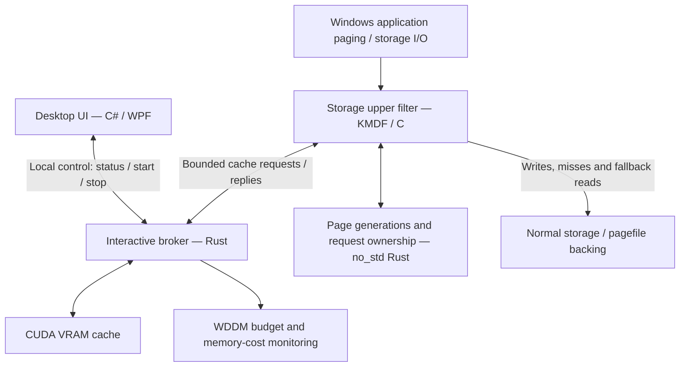

# SwappableVRAM

**A Windows experiment to use spare GPU memory as a low-latency paging cache and leave more physical RAM available for games.**

SwappableVRAM is intended for PCs with limited system RAM and a GPU that still has unused VRAM while gaming. The idea is to keep less frequently used background application data in a VRAM-backed paging tier, giving the game more room in physical RAM.

> [!IMPORTANT]
> **System-wide RAM offload does not work in the current development build.**
> The CUDA engine, diagnostics UI and local broker communication work, but the application does **not** currently move arbitrary Windows applications into VRAM. Driver signing/loading remains a blocker on a normal Windows installation, and the complete paging path still needs validation. There is no verified RAM saving, FPS improvement or frametime improvement yet.

## Why this project exists

A game rarely runs alone. Steam, Discord, a browser, OBS and desktop applications can continue using RAM in the background. On a machine short of physical RAM, the goal is to reduce the cost of bringing less frequently used data back into memory without taking the GPU memory the game needs.

An example workload is **CS2 + Steam + Discord + OBS + ChatGPT Desktop + Claude Desktop + Lightshot**. SwappableVRAM explores whether spare VRAM can help this kind of workload under real RAM pressure.

The success criteria are **net physical RAM saved and more consistent frame delivery**: page-fault latency, frametime p99 and 1% low FPS in repeatable game tests. Allocating several gigabytes of VRAM or making a RAM counter decrease would not, on its own, prove that the tool helps.

## What "using VRAM as RAM" means here

The proposed design uses VRAM as an optional cache for data passing through Windows paging/storage I/O. It does not add physical RAM to the CPU's memory controller or promise that an application can access VRAM at normal RAM latency.

Windows still manages application memory. The intended policy is to favor background data that is accessed infrequently, preserve physical RAM for the game, and release cache space when the GPU needs it. **Application selection and this end-to-end policy are not implemented as a working user feature yet.** A user-mode CUDA allocation cannot transparently relocate another application's memory pages.

The SSD remains the source of truth. VRAM stores disposable cache copies; it is not the only copy of a page. This lets the design fall back to the normal storage path when a cache entry is missing, stale, too late or unavailable. Those failure paths still need complete validation with the current driver.

## Current status

| Area | What exists | What is still missing |
| --- | --- | --- |
| GPU storage | Rust CUDA memory allocation, 4–64 KiB transfers, integrity checks and resource cleanup tested on an RTX 5060 | Evidence across other GPUs, drivers and game loads |
| Cache logic | SSD-backed cache model, per-page generations, range lookup, invalidation and cache revocation | Validation of the current complete kernel/GPU path |
| Windows driver | KMDF storage upper filter and an allocation-free Rust paging core; driver builds and static analysis pass | A normally installable package, current host paging tests and Driver Verifier validation |
| Interactive broker | Separate Rust process, authenticated local control channel, status queries, shutdown and malformed-message tests | A qualified, usable system offload mode |
| GPU memory budget | CUDA/DXGI adapter matching, process-local WDDM budget monitoring and allocation-cost measurements | Proven net RAM benefit and reliable behavior under real game pressure |
| Desktop UI | RAM/GPU/process monitoring, CUDA latency tests, JSON reports and a local broker connection check | A working action that offloads background application memory |
| Game performance | A target workload and measurement criteria | Controlled baseline/active comparisons; no performance claim is established |

Earlier isolated WinPE tests confirmed limited driver attachment, file integrity, pagefile notification and some fallback behavior in older driver revisions. They do not qualify the current protocol or demonstrate VRAM-backed application page faults on a normal desktop. Current user-mode development and tests run on the local Windows machine.

## Driver signing: why it is not ready to use

**The driver is awaiting a signing/loading path acceptable to Windows before normal-host integration testing can proceed.** There is no ready-to-install driver package for ordinary Windows use.

Temporary test-signed laboratory packages exist. They are not a production-trusted release, and building a `.sys` file or generating a catalog does not make Windows accept it. On the documented local host, test-signing is off and the SwappableVRAM driver is not installed.

Windows x64 enforces kernel-driver signing. A personal development setup can use a locally test-signed driver with the appropriate test-signing configuration; Secure Boot can prevent that configuration, and HVCI adds compatibility requirements. The application does not change boot settings, disable security features, install certificates, install its driver or reconfigure the pagefile automatically. See Microsoft's [test-signing requirements](https://learn.microsoft.com/en-us/windows-hardware/drivers/install/the-testsigning-boot-configuration-option) and [HVCI compatibility guidance](https://learn.microsoft.com/en-us/windows-hardware/test/hlk/testref/driver-compatibility-with-device-guard).

Microsoft production signing through attestation or WHQL is **not currently a committed project milestone**; personal development with a test package remains the chosen direction. This does not remove Windows' loading requirements. **Signing alone will not finish the project:** correct paging behavior, crash/timeout handling, physical RAM costs and game performance still need to be demonstrated.

## Architecture

The performance-sensitive engine and paging state logic are written in Rust. C provides the Windows KMDF bridge, and C#/WPF provides the desktop interface.



*This diagram describes the experimental design, not a working system-wide offload feature.*

The intended data path is:

1. **Writes continue to storage.** Overlapping writes invalidate cached generations so an old copy cannot be treated as current. Cache population is optional and must not delay the normal disk write.
2. **Eligible reads are offered to the broker.** A hit requires every page in the requested range to match its generation. The current range implementation supports aligned 4–64 KiB reads.
3. **A valid, timely hit can use the VRAM copy.** Missing pages, stale generations, expired requests, errors or broker loss must use the storage fallback. The filter has its own deadline; it must not depend on the GUI remaining responsive.
4. **The broker monitors its memory cost.** GPU budget pressure, non-local GPU memory growth and RAM/commit limits can disable the experimental cache. Allocated VRAM is not assumed to be free of system-memory costs.

The GUI talks to the broker through a local named pipe bound to the expected process, user and session. That control channel carries fixed-size commands and status, not arbitrary disk data. CUDA work stays in a separate process in the interactive user session. The current GUI connection check starts the normal probe profile, queries it and stops it; it does not enable the experimental driver path.

### Repository layout

| Path | Purpose |
| --- | --- |
| [`native/`](native/) | Rust CUDA engine, cache, broker, Windows I/O transport, WDDM monitoring and diagnostics |
| [`drivers/paging-core/`](drivers/paging-core/) | Allocation-free `no_std` Rust generation tracking and request ownership |
| [`drivers/kmdf/`](drivers/kmdf/) | Windows storage filter, control endpoint and kernel protocol bridge |
| [`src/SwappableVRAM.App/`](src/SwappableVRAM.App/) | WPF desktop interface |
| [`src/SwappableVRAM.Core/`](src/SwappableVRAM.Core/) | UI-side telemetry, native interop, measurements and broker control |
| [`src/SwappableVRAM.Diagnostics/`](src/SwappableVRAM.Diagnostics/) | Command-line diagnostics and integration checks |
| [`scripts/`](scripts/) | Build, package preparation and validation tools |
| [`tests/lab/`](tests/lab/) | Earlier isolated kernel-test harness and its evidence limits |
| [`docs/`](docs/) | Technical design notes and validation records; currently mostly in Turkish |
| [`third_party/`](third_party/) | Retained third-party license texts |

## What the existing tests establish

Local tests have exercised real CUDA transfers, cache integrity, cache revocation, Windows overlapped I/O cancellation and communication between the .NET controller and the Rust helper. They establish that individual components work in those test conditions.

For example, a documented RTX 5060 test using a 16 MiB pool checked 512 reads per range size. The same-process cache/GPU/checksum path measured approximately **50.7 µs p50 / 116.7 µs p99 at 4 KiB**, and **126.0 µs p50 / 197.6 µs p99 at 64 KiB**. These are historical component measurements, not Windows page-fault timings, game benchmarks or a guarantee that VRAM is faster than a particular SSD.

WDDM allocation tests also showed system commit and working-set costs. Commit is not the same as physical RAM usage, so the project must measure the net physical-memory result rather than equating VRAM capacity with RAM saved.

More detail: [range-cache measurements](docs/RANGE-CACHE.md), [broker pipeline](docs/BROKER-PIPELINE.md), [interactive control channel](docs/INTERACTIVE-BROKER.md) and [driver validation status](docs/DRIVER-STATUS.md). Raw development outputs live under the ignored `artifacts/` directory and are not included in this repository.

## Build and inspect the development UI

The current backend targets **Windows x64 with a CUDA-capable NVIDIA GPU**. There is no implemented AMD or Intel GPU backend. The interface currently uses Turkish text; this README is in English.

For user-mode builds, install Rust **1.97 or newer** with the MSVC toolchain, the MSVC x64 build tools, and the **.NET 8 SDK**. The NVIDIA driver must provide the CUDA Driver API; the CUDA Toolkit is not required.

Run from the repository root:

```powershell
# Publish the development UI and its Rust helper; does not launch or install them.
powershell -NoProfile -File scripts/Build-Desktop.ps1

# Run the UI yourself after a successful build.
.\artifacts\desktop\SwappableVRAM.App.exe
```

The published directory contains the self-contained desktop app, native engine and `SwappableVRAM.Broker.exe`. Opening it provides diagnostics and measurements, **not additional usable system RAM**. GPU latency tests allocate VRAM and add load while they run.

### Source and controller checks

```powershell
# Rust formatting, unit tests and Clippy, including the optional WDDM feature.
powershell -NoProfile -File scripts/Test-Source.ps1 -Wddm

# Exercise the actual local .NET/Rust control channel after publishing.
# This probe does not allocate a CUDA pool or activate system paging offload.
dotnet run --project src/SwappableVRAM.Diagnostics -c Release -- controller-test artifacts/desktop/SwappableVRAM.Broker.exe
```

Driver builds additionally use the project-local WDK/SDK **10.0.28000.2526** and KMDF **1.31**. The driver script currently contains a machine-specific Visual Studio/MSVC path that must be adjusted on other development machines. Package preparation is not installation, and its INF targets dedicated `SVRAMLAB` devices rather than ordinary physical disks. See [driver build and status notes](docs/DRIVER-STATUS.md).

## What remains before the goal is achieved

- Establish the local driver signing/loading and installation/rollback path.
- Validate the current filter, target identity, real application pagefile reads and GPU cache hits together on Windows.
- Complete coherence, timeout, cancellation, broker-exit, low-memory and Driver Verifier testing.
- Finish background-application policy and verify that the game's RAM and VRAM needs remain protected.
- Measure total physical RAM cost, WDDM residency and cache release under pressure.
- Run repeatable baseline/active game tests. Publish both improvements and regressions before claiming a performance benefit.

## Contributing and forks

Forks, issues and pull requests are welcome. Changes to the official repository are reviewed and approved by **[@aisa4digit](https://github.com/aisa4digit)**. See [CONTRIBUTING.md](CONTRIBUTING.md) for the contribution process.

Original project code is available under the [MIT License](LICENSE), copyright **2026 aisa4digit**. You may fork, modify and redistribute it, provided you retain the copyright and permission notice as required by that license. Forks can maintain their own changes; approval is required to merge into the official repository, not to create a fork. Third-party components retain their own licenses and attribution.

## Acknowledgments

- **[nbd-vram](https://github.com/c0dejedi/nbd-vram)** by Sean Lobjoit (`c0dejedi`) is the starting reference for the CUDA-backed storage idea. Its Linux NBD/swap integration is not shipped as a Windows backend; this repository develops its Windows integration separately.
- **[RamShared](https://github.com/emersonbusson/ramshared)** was examined for architectural ideas and Windows implementation status. Its source, services and driver are not incorporated here.
- The KMDF control-device adaptation retains the **Microsoft Public License (MS-PL)**. Optional Windows Rust bindings and their dependencies retain their respective licenses.

Full attribution and license boundaries are recorded in [THIRD_PARTY_NOTICES.md](THIRD_PARTY_NOTICES.md).
